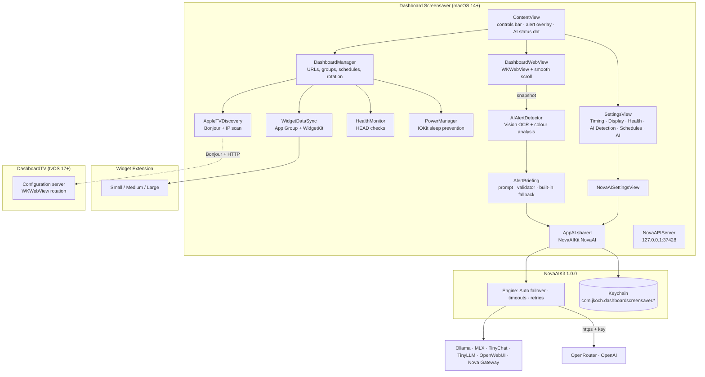
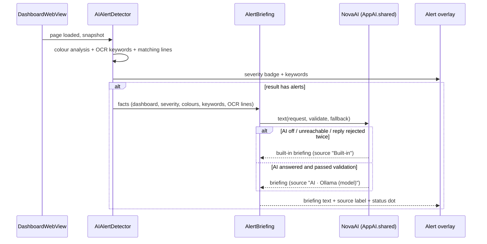

# Dashboard Screensaver

[](https://github.com/kochj23/DashboardScreensaver/actions)
[](https://github.com/kochj23/DashboardScreensaver/releases)


[](LICENSE)


A macOS app that rotates through web dashboards on a wall display or NOC screen. It watches each dashboard with
on-device Vision (alert colours + OCR), writes a short **AI briefing** when something looks wrong (NovaAIKit: local
Ollama/MLX/etc. or a keyed cloud backend, with a built-in fallback), checks dashboard health, follows time-based
schedules, feeds a macOS widget, and pushes configuration to a tvOS companion app.

- **Version:** 1.2.0 (build 2)
- **Platforms:** macOS 14+ (app + widget), tvOS 17+ (DashboardTV companion)
- **AI:** [NovaAIKit](https://github.com/kochj23/NovaAIKit) 1.0.0 — optional, off-switchable, keys only in the Keychain

---

## Table of Contents

- [Architecture](#architecture)
- [Features](#features)
- [AI](#ai)
- [Requirements](#requirements)
- [Installation](#installation)
- [Building](#building)
- [Usage](#usage)
- [Keyboard Shortcuts](#keyboard-shortcuts)
- [Alert Detection (Vision)](#alert-detection-vision)
- [Health Monitoring](#health-monitoring)
- [Schedule-Based Rotation](#schedule-based-rotation)
- [Apple TV Companion (DashboardTV)](#apple-tv-companion-dashboardtv)
- [macOS Widget](#macos-widget)
- [Local API Server](#local-api-server)
- [Security and Privacy](#security-and-privacy)
- [Testing](#testing)
- [Project Structure](#project-structure)
- [Troubleshooting](#troubleshooting)
- [Changelog](#changelog)
- [License](#license)

---

## Architecture



### Alert → briefing flow



### Technology Stack

| Layer              | Technology                                                  |
|--------------------|-------------------------------------------------------------|
| Language           | Swift 5.9                                                   |
| UI                 | SwiftUI                                                     |
| Web rendering      | WebKit (WKWebView)                                          |
| Alert detection    | Vision (VNRecognizeTextRequest) + pixel analysis, on-device |
| AI briefing        | NovaAIKit 1.0.0 (Swift Package)                             |
| Network discovery  | Network.framework (NWBrowser, Bonjour/mDNS)                 |
| Power management   | IOKit (IOPMAssertionCreateWithName)                         |
| Notifications      | UserNotifications                                           |
| Widgets            | WidgetKit + App Groups                                      |
| API server         | Network.framework (NWListener)                              |
| Secrets            | macOS Keychain (via NovaAIKit)                              |

---

## Features

### Dashboard Rotation
- Unlimited dashboard URLs in colour-coded groups.
- Rotation interval 5–300 s, page-load delay, smooth scroll, post-scroll dwell.
- Extra display time when alerts are detected (Low +5 s … Critical +30 s).
- Import URLs from CSV/TXT files or a remote HTTP list.

### Alert Detection and AI Briefing
- Screenshot colour analysis for red, orange and yellow alert regions.
- OCR keyword detection (critical, error, failed, down, outage, degraded, …) and content-change detection.
- **AI briefing:** when a dashboard is flagged, a one- or two-sentence note on what looks wrong and what to check
  first, written from the Vision facts and the OCR lines that contain alert words. Shown in the alert overlay with
  where it came from ("AI · Ollama (qwen3:8b)" or "Built-in").
- Notifications for High/Critical, optional auto-pause on Critical.

### Health Monitoring
- Background HEAD checks, success rates, consecutive-failure tracking, auto-skip of unhealthy URLs, recovery
  notifications.

### Schedule-Based Groups
- Business Hours / After Hours / Weekend or custom profiles, overnight ranges, day-of-week filters, priorities.

### Apple TV Remote Configuration
- Finds DashboardTV instances via Bonjour (IP scan fallback) and pushes groups and settings over HTTP.

### macOS Widget
- Small (health ring), Medium (current dashboard + countdown), Large (grid + controls).

### Display
- Glassmorphic UI, dark-mode CSS injection, screen sleep prevention, kiosk full screen, alert overlay.

### Local API
- `127.0.0.1:37428` (loopback only): `/api/status`, `/api/ping`.

---

## AI

AI in Dashboard Screensaver comes from [NovaAIKit](https://github.com/kochj23/NovaAIKit) 1.0.0 — the same AI feature
set every app in the family uses.

| | |
|---|---|
| **Where it's used** | The alert briefing in the alert overlay. Vision detection itself is on-device and never uses an AI backend. |
| **On/off** | Settings → **AI** → *Use AI*. Off = nothing is sent anywhere; alerts show the built-in Vision summary. |
| **Fallback** | Deterministic: "Critical alert on Payments API: error, down. "checkout-service DOWN" Content changed since the last rotation." Used when AI is off, every backend is down, or the reply is rejected twice. |
| **Backends** | Auto (failover), Ollama, MLX, TinyLLM, TinyChat, OpenWebUI, Nova Gateway, OpenRouter, OpenAI. Model picker and editable URL per backend; *Test connection*. |
| **Auto failover** | Ollama → MLX → TinyChat → TinyLLM → OpenWebUI → Nova Gateway → OpenRouter → OpenAI, with per-request timeouts, bounded retries (408/429/5xx) and a 60 s skip for a server that just failed. |
| **Validation** | Reply must be plain text, 12–280 characters, and every number in it must appear in the Vision facts (no invented error rates or host counts). A rejected reply is retried once with the reason, then the built-in briefing is used. |
| **Keys** | Only in the Keychain: service `com.jkoch.dashboardscreensaver.<backend>`, account `apiKey`. Keys are only ever sent over https. The settings screen shows "stored", never the key. |
| **Status** | `NovaAIStatusIndicator` in the controls bar (dot + backend/model/latency; click to re-check) and next to each briefing. |
| **Migration** | On first launch, settings of the old built-in `AIBackendManager` (backend, URLs, Ollama model, on/off) are imported; a plaintext OpenAI key in UserDefaults (`AIBackend_OpenAI_Key`) is moved into the Keychain and removed; the old Keychain item `com.jordankoch.DashboardScreensaver` / `AIBackend_OpenAI_Key` is moved; secrets of the removed Google Cloud, Azure, AWS and IBM Watson backends are deleted. |

Google Cloud, Azure, AWS and IBM Watson backends were removed in 1.2.0 (they were stubs). Use OpenRouter or the Nova
Gateway to reach hosted models. Image-generation backends (ComfyUI, Automatic1111, SwarmUI) were never used by this
app and are gone with the old manager.

The tvOS companion (DashboardTV) has no AI features; it only displays what the Mac pushes to it.

---

## Requirements

- macOS 14.0 (Sonoma) or later
- Xcode 26+ to build (NovaAIKit is fetched by Swift Package Manager)
- Optional: a local LLM server (Ollama on `http://localhost:11434` is the default) or an OpenRouter/OpenAI key for
  AI briefings
- DashboardTV: Apple TV with tvOS 17+, same local network

---

## Installation

### From DMG

1. Open `DashboardScreensaver-v1.2.0-build2.dmg`.
2. Drag **DashboardScreensaver** onto **Applications**.
3. Launch it from Applications.

Release builds are also kept in `/Volumes/Data/xcode/binaries/<date>-DashboardScreensaver-v<version>/` and on the NAS
under `/Volumes/NAS/binaries/`.

---

## Building

```bash
git clone git@github.com:kochj23/DashboardScreensaver.git
cd DashboardScreensaver

# macOS app (resolves NovaAIKit automatically)
xcodebuild -project DashboardScreensaver.xcodeproj -scheme DashboardScreensaver -configuration Release build

# tvOS companion (optional)
xcodebuild -project DashboardScreensaver.xcodeproj -scheme DashboardTV -configuration Release \
           -destination 'generic/platform=tvOS' build
```

The Release build has zero compiler warnings.

---

## Usage

### Getting Started

1. Launch Dashboard Screensaver.
2. Add dashboard URLs via the URL Manager (Cmd+N or click "Add Dashboard URL").
3. Organize dashboards into color-coded groups (Monitoring, Business, Security, General, or custom).
4. Configure rotation timing in Settings (Cmd+,).
5. Press Space or Cmd+P to start rotation.
6. Press F or Ctrl+F for full-screen kiosk mode.

### Adding Dashboards

Click the list icon or press Cmd+N, then enter a URL and optionally assign it to a group. Alternatively, import from a file:

- **CSV/TXT**: one URL per line.
- **Remote config**: an HTTP/HTTPS URL pointing to a line-separated list.
- **Auto-load on first launch**: place a `config.txt` file next to the app bundle, in your home directory, or at `~/.dashboardscreensaver/config.txt`.

If no configuration is found, the app loads default status pages (GitHub, AWS, Google Cloud).

### Setting Up Schedules

1. Open Settings, then the Schedules tab.
2. Enable "Schedule-Based Rotation."
3. Create schedule profiles with time ranges and day-of-week filters.
4. Assign dashboard groups to each profile.
5. Higher-priority profiles take precedence when multiple are active.

Default profiles: Business Hours (Mon--Fri 09:00--17:00), After Hours (Mon--Fri 17:00--09:00), Weekend (Sat--Sun all day).

### Configuring Apple TVs

1. Install DashboardTV on your Apple TVs.
2. Open the Apple TV Manager (Cmd+T).
3. Click "Scan Network" to discover devices via Bonjour (with IP range fallback).
4. Select a device, choose a dashboard group, and push the configuration.

---

## Keyboard Shortcuts

| Shortcut      | Action                  |
|---------------|-------------------------|
| Space         | Play / Pause rotation   |
| Right Arrow   | Next dashboard          |
| Left Arrow    | Previous dashboard      |
| Up / Home     | First dashboard         |
| Down / End    | Last dashboard          |
| N             | Next dashboard          |
| P             | Previous dashboard      |
| R             | Reload current page     |
| D             | Toggle dark mode CSS    |
| F / Ctrl+F    | Toggle full screen      |
| Cmd+,         | Open Settings           |
| Cmd+N         | Add Dashboard URL       |
| Cmd+I         | Import from file        |
| Cmd+]         | Next dashboard          |
| Cmd+[         | Previous dashboard      |
| Cmd+P         | Toggle rotation         |
| Cmd+T         | Apple TV Manager        |
| Cmd+/         | Keyboard shortcuts help |
| Esc           | Exit full screen        |

---

## Alert Detection (Vision)

`AIAlertDetector` snapshots each dashboard after it loads and analyses it on-device:

| Signal | How | Notes |
|--------|-----|-------|
| Red / orange / yellow regions | every 4th pixel classified by RGB thresholds | severity from the percentage vs. the alert threshold (default 5%) |
| Alert words | `VNRecognizeTextRequest` (fast) | keywords + up to 8 recognised lines containing them (fed to the AI briefing) |
| Content change | every 10th pixel vs. the previous snapshot | >5% changed sets the content-changed flag |

Severity ≥ High sends a notification (Critical uses the critical sound); Critical can pause rotation.

---

## Health Monitoring
- Background HEAD requests check URL availability at configurable intervals.
- Tracks success rates, consecutive failures, and average load times.
- Automatically skips unhealthy URLs after a configurable failure threshold.
- Sends notifications on failure and recovery.

### Schedule-Based Groups
- Define time-based rotation profiles (Business Hours, After Hours, Weekend, or custom).
- Assign dashboard groups to profiles with priority-based selection.
- Supports overnight schedules and day-of-week filtering.

### Apple TV Remote Configuration
- Discovers Apple TVs running DashboardTV via Bonjour/mDNS on the local network.
- Falls back to IP range scanning when Bonjour is unavailable.
- Pushes dashboard groups and settings to Apple TVs over HTTP.

### macOS Widget (WidgetKit)
- **Small**: Health ring showing healthy/total dashboards, rotation pulse, alert badge.
- **Medium**: Current dashboard name, health breakdown, next rotation countdown, pause/resume deep links.
- **Large**: Full dashboard grid with per-dashboard health indicators, rotation controls, alert count, schedule name.
- Refreshes every 60 seconds while rotating, every 5 minutes when paused.

### Display and UI
- Glassmorphic interface with animated floating blobs, glass card modifiers, and circular gauges (adapted from TopGUI design system).
- Dark mode CSS injection for light-themed dashboards.
- Screen sleep prevention via IOKit power assertions.
- Full-screen kiosk mode with hidden title bar.
- Alert overlay with severity badges and detected keywords.

### AI Backend Manager
- Auto-detects local LLM services: Ollama, MLX, TinyLLM, TinyChat, OpenWebUI.
- Auto-detects image generation backends: ComfyUI, Automatic1111, SwarmUI.
- Cloud AI support: OpenAI, Google Cloud, Azure, AWS, IBM Watson.
- All API keys stored in macOS Keychain -- never in UserDefaults or files.
- Auto-fallback: if the primary backend fails, generation falls through to the next available backend.
- Performance metrics and usage tracking per backend.

### Local API Server
- Binds to 127.0.0.1:37428 (loopback only -- no external exposure).
- `GET /api/status` returns running state, version, uptime.
- `GET /api/ping` returns a health check response.

---

## Requirements

- macOS 14.0 (Sonoma) or later
- Xcode 15.0+ (for building from source)
- Network access for dashboard loading and Apple TV discovery
- Recommended: secondary display for dedicated monitoring

For the tvOS companion app:
- Apple TV running tvOS 17.0 or later
- Both devices on the same local network

---

## Installation

### From DMG

1. Download the latest DMG from [Releases](https://github.com/kochj23/DashboardScreensaver/releases).
2. Open the DMG file.
3. Drag "Dashboard Screensaver" to your Applications folder.
4. Launch from Applications.

### Building from Source

```bash
git clone git@github.com:kochj23/DashboardScreensaver.git
cd DashboardScreensaver

# Build the macOS app
xcodebuild -project DashboardScreensaver.xcodeproj \
           -scheme DashboardScreensaver \
           -configuration Release \
           build

# Build the tvOS companion (optional)
xcodebuild -project DashboardScreensaver.xcodeproj \
           -scheme DashboardTV \
           -configuration Release \
           -destination 'platform=tvOS Simulator,name=Apple TV' \
           build
```

---

## Usage

### Getting Started

1. Launch Dashboard Screensaver.
2. Add dashboard URLs via the URL Manager (Cmd+N or click "Add Dashboard URL").
3. Organize dashboards into color-coded groups (Monitoring, Business, Security, General, or custom).
4. Configure rotation timing in Settings (Cmd+,).
5. Press Space or Cmd+P to start rotation.
6. Press F or Ctrl+F for full-screen kiosk mode.

### Adding Dashboards

Click the list icon or press Cmd+N, then enter a URL and optionally assign it to a group. Alternatively, import from a file:

- **CSV/TXT**: one URL per line.
- **Remote config**: an HTTP/HTTPS URL pointing to a line-separated list.
- **Auto-load on first launch**: place a `config.txt` file next to the app bundle, in your home directory, or at `~/.dashboardscreensaver/config.txt`.

If no configuration is found, the app loads default status pages (GitHub, AWS, Google Cloud).

### Setting Up Schedules

1. Open Settings, then the Schedules tab.
2. Enable "Schedule-Based Rotation."
3. Create schedule profiles with time ranges and day-of-week filters.
4. Assign dashboard groups to each profile.
5. Higher-priority profiles take precedence when multiple are active.

Default profiles: Business Hours (Mon--Fri 09:00--17:00), After Hours (Mon--Fri 17:00--09:00), Weekend (Sat--Sun all day).

### Configuring Apple TVs

1. Install DashboardTV on your Apple TVs.
2. Open the Apple TV Manager (Cmd+T).
3. Click "Scan Network" to discover devices via Bonjour (with IP range fallback).
4. Select a device, choose a dashboard group, and push the configuration.

---

## Keyboard Shortcuts

| Shortcut      | Action                  |
|---------------|-------------------------|
| Space         | Play / Pause rotation   |
| Right Arrow   | Next dashboard          |
| Left Arrow    | Previous dashboard      |
| Up / Home     | First dashboard         |
| Down / End    | Last dashboard          |
| N             | Next dashboard          |
| P             | Previous dashboard      |
| R             | Reload current page     |
| D             | Toggle dark mode CSS    |
| F / Ctrl+F    | Toggle full screen      |
| Cmd+,         | Open Settings           |
| Cmd+N         | Add Dashboard URL       |
| Cmd+I         | Import from file        |
| Cmd+]         | Next dashboard          |
| Cmd+[         | Previous dashboard      |
| Cmd+P         | Toggle rotation         |
| Cmd+T         | Apple TV Manager        |
| Cmd+/         | Keyboard shortcuts help |
| Esc           | Exit full screen        |

---

## AI Alert Detection

The AIAlertDetector captures a screenshot of each dashboard after loading and analyzes it using two techniques:

### Color Analysis

Pixels are sampled (every 4th pixel for performance) and classified:

| Color  | Threshold          | Severity Mapping          |
|--------|--------------------|---------------------------|
| Red    | R > 0.6, G < 0.4, B < 0.4  | High / Critical    |
| Orange | R > 0.8, 0.3 < G < 0.7, B < 0.3 | Medium / High |
| Yellow | R > 0.7, G > 0.7, B < 0.4 | Low / Medium        |

Severity is determined by the percentage of alert-colored pixels relative to a configurable threshold (default 5%).

### OCR Keyword Detection

The Vision framework's `VNRecognizeTextRequest` (fast mode, no language correction) extracts text and matches against:

- **Critical**: critical, emergency, outage, down
- **High**: error, failed, failure, danger
- **Medium**: warning, degraded, incident
- **Low**: alert, urgent, offline, unhealthy

### Content Change Detection

Screenshots are compared between rotations by sampling every 10th pixel. A change exceeding 5% of sampled pixels triggers a content-changed flag.

### Alert Behavior

- Severity >= High: system notification sent (critical alerts use `defaultCritical` sound).
- Severity == Critical with `pauseOnCritical` enabled: rotation pauses automatically.
- Extra display time is added based on severity (Low: +5s, Medium: +10s, High: +20s, Critical: +30s).

---

## Health Monitoring

The HealthMonitor runs background availability checks using concurrent `HEAD` requests:

- HTTP 200--399: Healthy
- HTTP 400--499: Degraded
- HTTP 500--599 or network error: Failed

Dashboards are marked as failed after reaching the configurable failure threshold (default: 3 consecutive failures). Failed URLs are skipped during rotation when `skipUnhealthyURLs` is enabled and are retried after the retry interval (default: 600 seconds). Notifications are sent on both failure and recovery events.

---

## Schedule-Based Rotation

Schedule profiles define which dashboard groups are active during specific time windows. Each profile specifies:

- Start time and end time (supports overnight ranges, e.g. 22:00--06:00)
- Enabled days of the week
- A priority value (higher priority wins when multiple profiles overlap)
- A list of assigned dashboard group IDs

When scheduling is enabled, only dashboards belonging to the active profile's groups are included in rotation.

---

## Apple TV Companion (DashboardTV)

DashboardTV is a tvOS 17+ companion app that receives configuration from the macOS app over the local network:

- Advertises itself via Bonjour (`_dashboardtv._tcp`).
- Exposes `GET /api/info` for device identification and `POST /api/configure` for receiving dashboard URLs and settings.
- Supports independent rotation with its own timer and dark mode injection.

The macOS app discovers DashboardTV instances via Bonjour and falls back to scanning the local /24 subnet on port 8080.

---

## macOS Widget

The widget extension uses WidgetKit and communicates with the main app through an App Group (`group.com.jordankoch.DashboardScreensaver`). The `WidgetDataSync` manager writes current rotation state, health counts, and a recent-dashboards list to shared UserDefaults, then triggers a timeline reload via `WidgetCenter`.

Three widget sizes are supported:

- **Small**: A health ring gauge (healthy/total), rotation status pulse, and an alert badge.
- **Medium**: Current dashboard name, health breakdown (healthy/degraded/failed), next rotation countdown, and deep links for pause/resume.
- **Large**: A dashboard grid showing per-dashboard health dots, rotation controls, alert count, and the active schedule name.

---

## Local API Server

The `NovaAPIServer` starts automatically on launch and listens on `127.0.0.1:37428` (TCP, loopback only). It provides two endpoints:

```bash
# Application status (returns JSON with app name, version, port, uptimeSeconds)
curl -s http://127.0.0.1:37428/api/status | python3 -m json.tool

# Health check
curl -s http://127.0.0.1:37428/api/ping
```

The server uses `NWListener` from Network.framework with raw TCP request parsing. No external network exposure.

---

## Security and Privacy

- **No sandbox:** needed for network access, IOKit power management and the loopback API server. Hardened runtime.
- **Local data:** dashboards and settings live in UserDefaults; AI settings in UserDefaults contain no secrets.
- **Keys:** AI keys only in the Keychain (`com.jkoch.dashboardscreensaver.*`), only sent over https. 1.2.0 removes a
  plaintext OpenAI key and the old Google/Azure/AWS/IBM secrets left in UserDefaults by the previous AI manager.
- **What leaves the Mac:** nothing unless AI is on. With AI on, the briefing request carries the dashboard name, the
  alert words, colour percentages and the OCR lines that contain alert words — to the backend you chose (local by
  default). Screenshots never leave the Mac.
- **Loopback API:** `127.0.0.1` only.

---

## Testing

111 XCTest cases, all passing (`xcodebuild test -project DashboardScreensaver.xcodeproj -scheme DashboardScreensaverTests`).

| Suite | Tests | Covers |
|-------|------:|--------|
| Model / widget suites (DashboardURL, schedules, severities, widget data, …) | 78 | data models, schedules, codable, widget health |
| SecurityTests | 7 | no hardcoded credentials or passwords, AI keys via NovaAIKit, loopback API, safe URLs, headers |
| AISecurityTests | 6 | Keychain service names, plaintext key leaves UserDefaults, old Keychain item migrated once, keys not in settings, no key over http, no old AI client left |
| AIPerformanceTests | 3 | AI-off fallback is immediate, offline fallback doesn't hang, huge OCR input is capped |
| AIRetryTests | 3 | 503 retried, rejected reply asked again, twice-rejected → built-in |
| AIUnitTests | 7 | fallback text, validator accept/reject, `<think>` stripping, facts, clamping, backend catalogue |
| AIIntegrationTests | 2 | Ollama `/api/chat` round trip through the kit, legacy settings import |
| AIFunctionalTests | 2 | every severity works with AI off; offline → built-in |
| AIFrameTests | 3 | status/toggle/source state, settings + status views render, detector initial state |

AI tests use in-memory settings and keys and a stub `URLProtocol`; they never touch the real Keychain or network.

---

## Project Structure

```
DashboardScreensaver/
    DashboardScreensaverApp.swift        App entry, menu commands, AppState
    NovaAPIServer.swift                  Loopback HTTP API (port 37428)
    AI/
        AppAI.swift                      The app's NovaAI instance + one-time legacy migration
        AlertBriefing.swift              Briefing prompt, validator, built-in fallback
        AIAlertDetector.swift            Vision colour + OCR detection, triggers the briefing
    Managers/                            DashboardManager, HealthMonitor, PowerManager, WidgetDataSync
    Network/AppleTVDiscovery.swift       Bonjour + IP scan
    Views/                               ContentView, DashboardWebView, SettingsView, URLManagerView, AppleTVManagerView
Shared/                                  Models, ModernDesign, WidgetData (macOS + tvOS)
DashboardScreensaver Widget/             WidgetKit extension
DashboardTV/                             tvOS companion
DashboardScreensaverTests/               XCTest suites (incl. AIKitAdoptionTests.swift)
```

---

## Troubleshooting

| Symptom | Fix |
|---------|-----|
| Dashboards don't load | Check the URL in a browser; log in once in the web view for authenticated dashboards; try without dark-mode CSS. |
| No alerts detected | AI Detection on (Settings → AI Detection); lower the threshold; OCR needs legible text. |
| Briefing always says "Built-in" | Settings → AI: *Use AI* on, pick a backend, *Test connection*. With Auto, start Ollama (`ollama serve`) or add an OpenRouter key. |
| Status dot orange | The selected backend is unreachable; click the dot to re-check. |
| Apple TVs not found | DashboardTV running, same network, Bonjour (UDP 5353) allowed; try the IP scan. |
| Widget not updating | App running; App Group `group.com.jordankoch.DashboardScreensaver` on both targets. |

---

## Changelog

See [CHANGELOG.md](CHANGELOG.md). Highlights:

- **1.2.0** — AI migrated to NovaAIKit 1.0.0: AI alert briefing with built-in fallback and validation, AI settings
  tab, status indicator, Keychain-only keys, legacy key migration; Google/Azure/AWS/IBM backends removed.
- **1.1.0** — macOS widget (small/medium/large), App Group sync.
- **1.0.0** — Initial release.

---

## License

MIT License -- Copyright (c) 2026 Jordan Koch

Permission is hereby granted, free of charge, to any person obtaining a copy of this software and associated documentation files (the "Software"), to deal in the Software without restriction, including without limitation the rights to use, copy, modify, merge, publish, distribute, sublicense, and/or sell copies of the Software, and to permit persons to whom the Software is furnished to do so, subject to the following conditions:

The above copyright notice and this permission notice shall be included in all copies or substantial portions of the Software.

THE SOFTWARE IS PROVIDED "AS IS", WITHOUT WARRANTY OF ANY KIND, EXPRESS OR IMPLIED, INCLUDING BUT NOT LIMITED TO THE WARRANTIES OF MERCHANTABILITY, FITNESS FOR A PARTICULAR PURPOSE AND NONINFRINGEMENT. IN NO EVENT SHALL THE AUTHORS OR COPYRIGHT HOLDERS BE LIABLE FOR ANY CLAIM, DAMAGES OR OTHER LIABILITY, WHETHER IN AN ACTION OF CONTRACT, TORT OR OTHERWISE, ARISING FROM, OUT OF OR IN CONNECTION WITH THE SOFTWARE OR THE USE OR OTHER DEALINGS IN THE SOFTWARE.

See [LICENSE](LICENSE) for the full text.

---

## Author

Written by **Jordan Koch**.

- GitHub: [@kochj23](https://github.com/kochj23)

---

> **Disclaimer:** This is a personal project created on my own time. It is not affiliated with, endorsed by, or representative of my employer.
